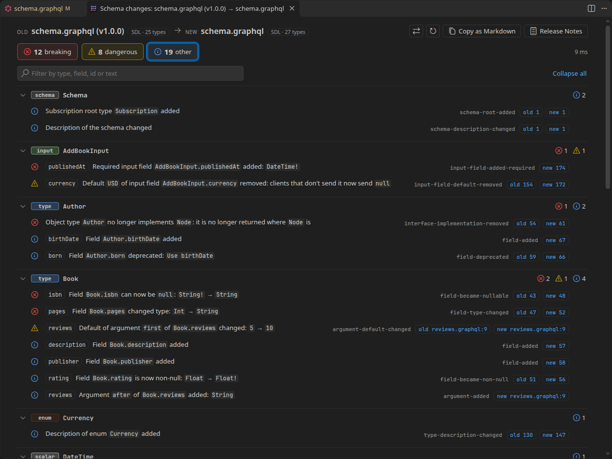
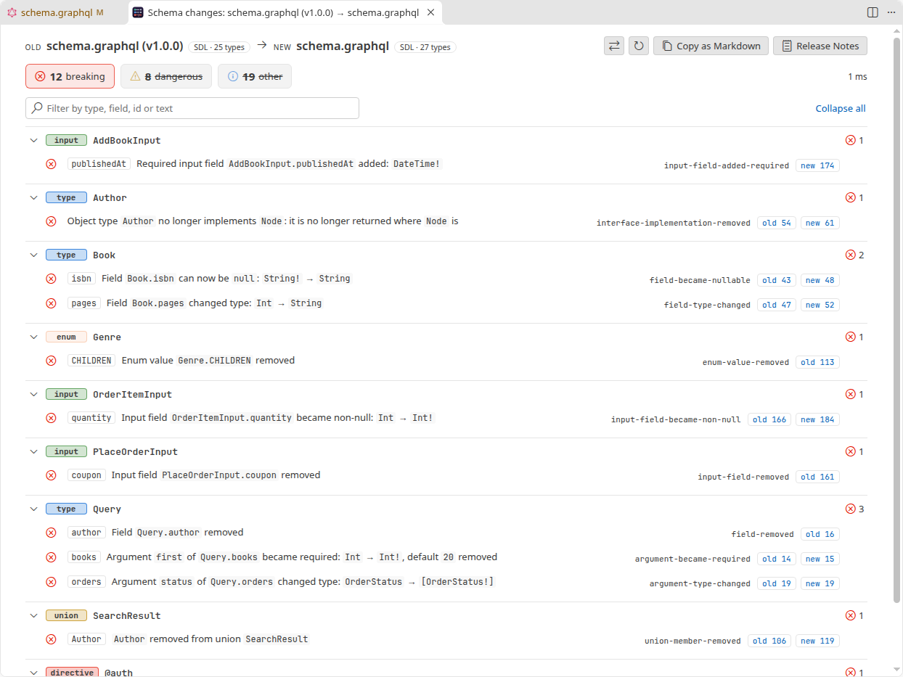
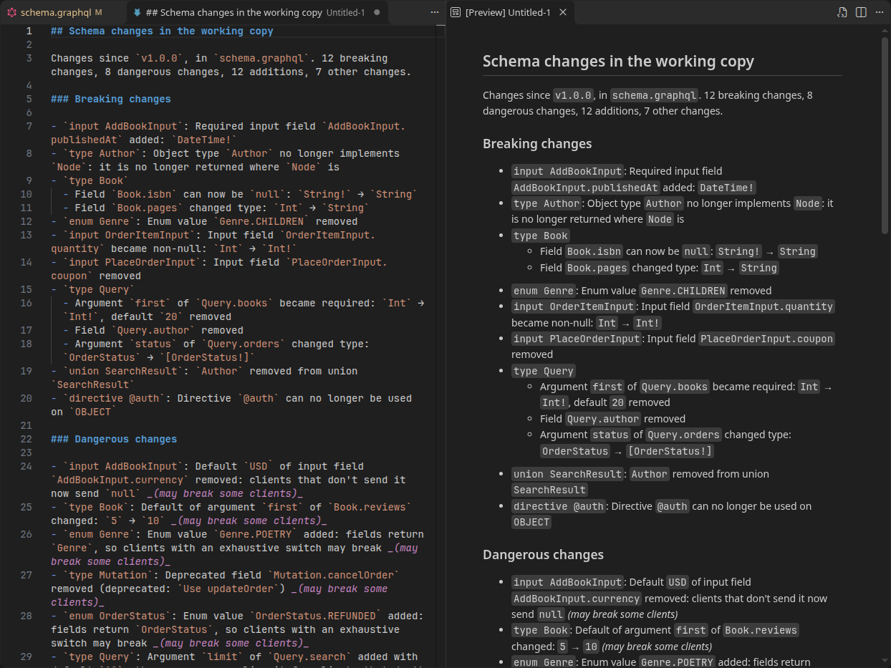
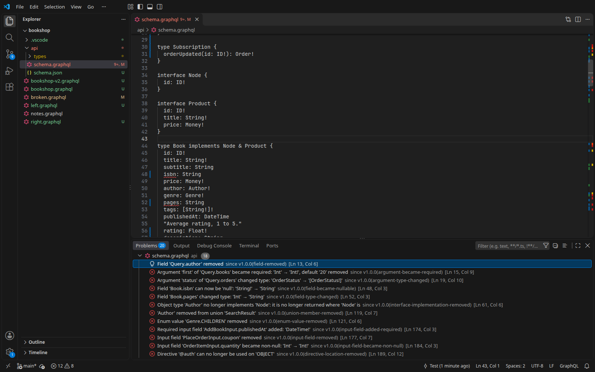

<h1 align="center">
  <br>
  GraphQL Breaking Changes
</h1>

<p align="center">
  Diff two versions of a GraphQL schema and see what changed for the clients of your API.
</p>

<p align="center">
  <a href="https://github.com/heyliamme/graphql-breaking-changes/blob/main/CHANGELOG.md">Changelog</a> ·
  <a href="https://github.com/heyliamme/graphql-breaking-changes/blob/main/CONTRIBUTING.md">Contributing</a>
</p>



A text diff of a schema tells you which lines moved. It doesn't tell you that `Book.isbn`
losing its `!` means every client that trusted it now has to handle `null`, that the
enum value you added will trip exhaustive switches in generated code, or that making an
argument required rejects every query written before today. This extension reads both
versions of the schema and lists the changes as a client sees them:

- **Breaking**: queries or clients that work today will fail. A removed type, field, enum
  value or union member; a field that can now be `null`; a new required argument or input
  field; a removed directive location.
- **Dangerous**: depends on the client. A new enum value or union member (exhaustive
  switches and fragments stop being exhaustive); a default value added or changed (the
  server does something new for clients that omit it); a deprecated field removed.
- **Other**: everything else clients can see: new types and fields, deprecations,
  descriptions, directives applied.

Direction matters: a field becoming non-null is safe for the client that reads it, while
an argument becoming non-null is breaking for the client that sends it. Every change is
judged from the side it affects.

It reads SDL (`.graphql`, `.graphqls`, `.gql`), schemas split across many files with their
`extend type` extensions, and introspection results (`schema.json`, as codegen and Apollo
write them), in any combination: an introspection result against the SDL it came from
has no changes. Federation subgraphs compare as they are: `@key`, `@external`,
`extend type` of a type defined elsewhere, no directive definitions needed. It runs
locally in the editor; nothing is sent anywhere.

## Install

From the [Visual Studio Marketplace](https://marketplace.visualstudio.com/items?itemName=heyliam.graphql-breaking-changes),
from [Open VSX](https://open-vsx.org/extension/heyliam/graphql-breaking-changes) (VSCodium,
Cursor and other editors), or from a terminal:

```bash
code --install-extension heyliam.graphql-breaking-changes
```

## Getting started

Open a schema and press <kbd>Ctrl</kbd>+<kbd>K</kbd> <kbd>B</kbd>
(<kbd>Cmd</kbd>+<kbd>K</kbd> <kbd>B</kbd> on macOS), then pick the branch or
tag to compare with, for example `main` or the tag of the last release.

| To compare | Do this |
| --- | --- |
| Your working copy with the last commit | **Compare with HEAD**, in the editor's context menu under **GraphQL Breaking Changes** |
| Your working copy with a branch, tag or commit | <kbd>Ctrl</kbd>+<kbd>K</kbd> <kbd>B</kbd>, or **Compare with Git Branch or Tag…** |
| Two releases, for release notes | **Write Release Notes…**: pick the last release, then the new one (or the working copy) |
| The current schema with another file | **Compare with Another Schema…**: lists the schema files in the workspace, SDL and introspection |
| Two files in the Explorer | Select both, right-click, **Compare Schemas for Breaking Changes**. The old one is told by the names (`schema-old` / `schema-new`, `schema` / `schema-v2`); when they don't say, you're asked. **⇄** swaps them. |
| The two sides of a diff editor (Source Control, a pull request, Timeline) | The button in the editor title bar, or <kbd>Ctrl</kbd>+<kbd>K</kbd> <kbd>B</kbd> |

Files are recognised as schemas by their content (type definitions, or a `__schema`
introspection result), whatever they are called.

## The report

- **Counts** at the top: breaking, dangerous, other, and ignored. Click one to hide or
  show that level.
- **Grouped by type**, with the schema's own changes (root types, description) first and
  directive definitions last. Within a type, breaking changes come first, then by field;
  each row names the field, input field, enum value or union member it is about.
- **Search** by type, field, change id or text: <kbd>/</kbd> jumps to the box.
- **Click a change**, or the `old 42` / `new 57` buttons, to open the schema at that line.
  For a split schema the button names the file. For an introspection result it opens the
  JSON at the type, field or argument.
- **Copy as Markdown** puts a changelog on the clipboard for a pull request, grouped by
  type.
- **Release Notes** opens the same changes as release notes for clients (below).
- **Ignore** (the eye on each change) adds a rule to the settings: this change, every
  change of that kind, everything on that field, or everything on that type.

The report follows your edits: change the schema, or any file it is merged with, and it
updates.



## Release notes

**Write Release Notes…** (in the Command Palette and the editor's context menu) asks for
the last release, offering the latest tag first, and then the new one: the working copy, a
tag, branch or commit. It opens Markdown for the people who use the API, ready to edit and
paste into a release:

```markdown
## Schema changes in `v2.0.0`

Changes since `v1.0.0`, in `schema.graphql`. 12 breaking changes, 8 dangerous changes, 12 additions, 7 other changes.

### Breaking changes

- `type Book`
  - Field `Book.isbn` can now be `null`: `String!` → `String`
  - Field `Book.pages` changed type: `Int` → `String`
- `type Query`
  - Argument `first` of `Query.books` became required: `Int` → `Int!`, default `20` removed
  - Field `Query.author` removed
…

### Dangerous changes

- `enum OrderStatus`: Enum value `OrderStatus.REFUNDED` added: fields return `OrderStatus`, so clients with an exhaustive switch may break _(may break some clients)_
…

### Added

- `type Mutation`: Field `Mutation.deleteBook` added
…
```

Breaking changes come first, then dangerous ones, then what is new, then everything else.
Ignored changes are left out. The **Release Notes** button in a report does the same for
the two sides it compares.



## Breaking changes in the Problems panel

Set `graphqlBreakingChanges.baseRef` to the branch or tag your API is released from, and
every open schema file is checked against it as you type. Breaking changes show up as
problems on the field, argument or value that caused them. A removal shows on what is left
of it: a removed field on its type, a removed argument on its field, a removed type at the
top of the file it was in:

```jsonc
// .vscode/settings.json
"graphqlBreakingChanges.baseRef": "main"
```



A change in another file of a split schema is a problem in that file, and editing that
file checks the schema again. A file that is only a part of a split schema (no root type,
no `schema` block) is checked as the whole schema of the nearest main file in its folder
or a folder above it, so a type moved into another file is not taken for removed. If the ref names no branch, tag or commit in the repository
(a typo, or a branch not fetched yet), a message says so. When the check can't run (the
schema doesn't parse, Git isn't available, or the schema can't be read at the ref), a
note on the first line of the file says why, and when only some files of a huge split
schema could be read, a note says that too. So an empty Problems panel means no breaking
changes.

The quick fix (<kbd>Ctrl</kbd>+<kbd>.</kbd>) opens the full report or ignores the change.
`graphqlBreakingChanges.problemsLevel` chooses which levels appear (by default, breaking
and dangerous).

## Schemas split across files

A schema kept as several files (`schema.graphql` with `types/*.graphql` holding
`extend type Query { … }` and more types) is read as one. `graphqlBreakingChanges.schemaFiles`
(default `**/*.{graphql,graphqls,gql}`) names the other files, as a glob matched relative to the folder of
the file you compare, so comparing any file of the split brings in the files next to it and
below, except in `node_modules`, `dist`, `out`, `build` and `vendor` folders, on disk and
at a Git ref alike. Files that hold only queries or fragments are left out, and so is a file that
defines a type the file you compare defines too: that is another version of the schema
(`schema-v2.graphql` next to `schema.graphql`), not a part of it. A file that doesn't
parse is left out with a note in the report. When a type is defined twice, the definition
in the file you compare wins, then the first by path, and the report says so.

Comparing with a Git ref reads every file at that ref, so a file deleted since then still
counts: its types are reported as removed. Set the pattern to `""` to compare one file on
its own.

## Introspection results

A `schema.json` (the result of the introspection query, with or without the `data`
wrapper) compares like SDL, on either side. Descriptions, deprecations, default values,
`@specifiedBy` and `@oneOf` are read when the result includes them; applied directives
other than those are not part of introspection, so a schema's `@key` or `@auth` show as
removed when its introspection result is compared with its SDL.

## Settings

| Setting | Default | |
| --- | --- | --- |
| `graphqlBreakingChanges.ignore` | `[]` | Changes to leave out of the counts and the Problems panel. See below. |
| `graphqlBreakingChanges.treatWarningsAsErrors` | `false` | Count dangerous changes as breaking. |
| `graphqlBreakingChanges.schemaFiles` | `"**/*.{graphql,graphqls,gql}"` | The other files of a split schema, relative to the folder of the file being compared. Empty: one file. |
| `graphqlBreakingChanges.baseRef` | `""` | Branch, tag or commit to check open schemas against in the Problems panel. Empty turns it off. |
| `graphqlBreakingChanges.problemsLevel` | `"warning"` | `error`: only breaking changes; `warning`: breaking and dangerous; `info`: all. |

Every setting can differ per folder, so a multi-root workspace with several APIs can give
each its own baseline and rules in the folder's `.vscode/settings.json`.

### Ignore rules

```jsonc
"graphqlBreakingChanges.ignore": [
  "enum-value-added",                                        // a change id, anywhere
  "*-description-changed",                                   // * matches any run of characters
  { "type": "Internal*", "reason": "not public" },           // every change on these types
  { "id": "field-removed", "type": "User", "field": "legacyId" },
  { "type": "@auth" }                                        // a directive definition
]
```

Ignored changes stay in the report, dimmed and struck through with their reason, and are
left out of the counts, the Problems panel, the Markdown changelog and the release notes.
`field` matches a field, input field, enum value or union member; for a change to an
argument it matches the argument's field.

In [Restricted Mode](https://code.visualstudio.com/docs/editor/workspace-trust) the
workspace's `ignore`, `baseRef` and `schemaFiles` settings are not applied, so a
repository you just cloned can't hide its own breaking changes or point the comparison at
files of its choosing, and nothing that runs Git starts. Comparing two files still works
there; **Ignore** then offers to put the rule in your user settings.

## Commands

All are under **GraphQL Breaking Changes** in the Command Palette.

| Command | |
| --- | --- |
| Compare with HEAD | The current schema against its last commit. |
| Compare with Git Branch or Tag… | Pick a branch, tag or remote branch, or type a commit or an expression such as `HEAD~3`. Recently used refs come first, tags newest first. |
| Compare with Another Schema… | Pick another schema in the workspace (SDL or introspection), or browse. |
| Write Release Notes… | Release notes between two versions of the current schema. |
| Check This Diff for Breaking Changes | The two sides of the active diff editor. |
| Show Changes Since Baseline | The current schema against `graphqlBreakingChanges.baseRef`. |

## How levels are chosen

The question is always: does a client that works today, written against the old schema,
still work? Some calls are judgement calls, made on purpose:

- **A field that can now be `null` is breaking**, at any depth: `[String!]` → `[String]`
  too. Generated types and hand-written code alike assume the non-null they were given.
- **A new enum value is dangerous only where a field returns the enum.** An enum that is
  only ever sent by clients gains nothing they have to handle, so there it is
  informational.
- **A new union member or a new implementor of an interface is dangerous**: a query that
  spread fragments over every member stops covering them all, and gets back objects with
  only `__typename`.
- **A new optional argument or input field is informational when it has no default**:
  existing queries are unaffected. **With a default it is dangerous**, because the server
  now does something for every client that leaves it out. A default added to a value that
  was required is informational: those clients always sent it.
- **An argument or input field that becomes non-null is breaking**; when a default is added
  at the same time, clients that omit it still work and only those sending an explicit
  `null` break, so it is dangerous.
- **Removing a deprecated field, argument, input field or enum value is dangerous**, not
  breaking: clients were told. Removing one that wasn't deprecated is breaking.
- **Applied directives are informational**, federation's included (`@key`, `@external`,
  `@shareable`, …): they describe how the graph is composed, not what a client can query.
  Clients that depend on a custom directive can watch `directive-usage-*` through
  `treatWarningsAsErrors` and ignore rules.
- **Descriptions are informational**, and kept: they are the documentation clients read.

## Detected changes

Each change has an id, used in ignore rules and shown in the report and the Problems
panel. Arguments, input fields and directive arguments share one set of rules, since all
three are values the client sends: `argument-became-required`, `input-field-became-required`
and `directive-argument-became-required` are the same rule in three places.

#### Schema

| Id | Level | Change |
| --- | --- | --- |
| `schema-root-changed` | breaking | The query, mutation or subscription root is another type |
| `schema-root-removed` | breaking | The mutation or subscription root type was removed |
| `schema-root-added` | info | A mutation or subscription root type was added |
| `schema-description-changed` | info | The schema's description changed |

#### Types

| Id | Level | Change |
| --- | --- | --- |
| `type-added` | info | A type was added |
| `type-removed` | breaking | A type was removed |
| `type-kind-changed` | breaking | A type changed kind (object type → interface, enum → scalar, …) |
| `type-description-changed` | info | A type's description changed |
| `scalar-specified-by-changed` | info | `@specifiedBy` of a scalar was added, removed or changed |

#### Fields

| Id | Level | Change |
| --- | --- | --- |
| `field-added` | info | A field was added to an object type or interface |
| `field-removed` | breaking | A field was removed |
| `deprecated-field-removed` | dangerous | A deprecated field was removed |
| `field-type-changed` | breaking | A field's type changed (another type, or other list nesting) |
| `field-became-nullable` | breaking | A field, or the items of a list field, can now be `null` |
| `field-became-non-null` | info | A field, or the items of a list field, can no longer be `null` |
| `field-deprecated` | info | A field was marked deprecated |
| `field-deprecation-removed` | info | A field is no longer deprecated |
| `field-deprecation-reason-changed` | info | A field's deprecation reason changed |
| `field-description-changed` | info | A field's description changed |

#### Arguments

| Id | Level | Change |
| --- | --- | --- |
| `argument-added` | dangerous when it has a default value (the server now does something for clients that omit it), else info | An optional argument was added |
| `argument-added-required` | breaking | A required argument (non-null, no default) was added |
| `argument-removed` | breaking; dangerous when the new side is an introspection result made without `isDeprecated` on input values, which leaves deprecated ones out (it may only have been deprecated) | An argument was removed |
| `deprecated-argument-removed` | dangerous | A deprecated argument was removed |
| `argument-type-changed` | breaking | An argument's type changed (another type, or other list nesting) |
| `argument-became-required` | breaking | An argument became required: non-null without a default, or its default was removed |
| `argument-became-non-null` | breaking; dangerous when a default value was added with it | An argument, or the items of a list argument, can no longer be `null` |
| `argument-became-nullable` | info | An argument, or the items of a list argument, can now be `null` |
| `argument-default-added` | dangerous (the server now does something for clients that omit it); info when the argument was required before, so clients always send it | A default value was added |
| `argument-default-changed` | dangerous | The default value changed |
| `argument-default-removed` | dangerous | The default value of a nullable argument was removed (omitting it now means `null`) |
| `argument-deprecated` | info | An argument was marked deprecated |
| `argument-deprecation-removed` | info | An argument is no longer deprecated |
| `argument-deprecation-reason-changed` | info | An argument's deprecation reason changed |
| `argument-description-changed` | info | An argument's description changed |

#### Input objects

| Id | Level | Change |
| --- | --- | --- |
| `input-field-added` | dangerous when it has a default value (the server now does something for clients that omit it), else info | An optional input field was added |
| `input-field-added-required` | breaking | A required input field (non-null, no default) was added |
| `input-field-removed` | breaking; dangerous when the new side is an introspection result made without `isDeprecated` on input values, which leaves deprecated ones out (it may only have been deprecated) | An input field was removed |
| `deprecated-input-field-removed` | dangerous | A deprecated input field was removed |
| `input-field-type-changed` | breaking | An input field's type changed (another type, or other list nesting) |
| `input-field-became-required` | breaking | An input field became required: non-null without a default, or its default was removed |
| `input-field-became-non-null` | breaking; dangerous when a default value was added with it | An input field, or the items of a list input field, can no longer be `null` |
| `input-field-became-nullable` | info | An input field, or the items of a list input field, can now be `null` |
| `input-field-default-added` | dangerous (the server now does something for clients that omit it); info when the input field was required before, so clients always send it | A default value was added |
| `input-field-default-changed` | dangerous | The default value changed |
| `input-field-default-removed` | dangerous | The default value of a nullable input field was removed (omitting it now means `null`) |
| `input-field-deprecated` | info | An input field was marked deprecated |
| `input-field-deprecation-removed` | info | An input field is no longer deprecated |
| `input-field-deprecation-reason-changed` | info | An input field's deprecation reason changed |
| `input-field-description-changed` | info | An input field's description changed |
| `input-one-of-added` | breaking | `@oneOf` was added: exactly one field must now be given |
| `input-one-of-removed` | info | `@oneOf` was removed |

#### Enums

| Id | Level | Change |
| --- | --- | --- |
| `enum-value-added` | dangerous when a field returns the enum (exhaustive switches break), else info | An enum value was added |
| `enum-value-removed` | breaking | An enum value was removed |
| `deprecated-enum-value-removed` | dangerous | A deprecated enum value was removed |
| `enum-value-deprecated` | info | An enum value was marked deprecated |
| `enum-value-deprecation-removed` | info | An enum value is no longer deprecated |
| `enum-value-deprecation-reason-changed` | info | An enum value's deprecation reason changed |
| `enum-value-description-changed` | info | An enum value's description changed |

#### Unions and interfaces

| Id | Level | Change |
| --- | --- | --- |
| `union-member-added` | dangerous | A type was added to a union (fragments that cover every member stop doing so) |
| `union-member-removed` | breaking | A type was removed from a union |
| `interface-implementation-added` | dangerous for an object type and an interface that already existed (fragments that cover every implementor stop doing so); info for an interface, which is never returned itself, or an interface that is new too | A type now implements an interface |
| `interface-implementation-removed` | breaking | A type no longer implements an interface |

#### Directives

| Id | Level | Change |
| --- | --- | --- |
| `directive-added` | info | A directive was defined |
| `directive-removed` | breaking | A directive definition was removed |
| `directive-location-added` | info | A directive can be used in a new location |
| `directive-location-removed` | breaking | A directive can no longer be used in a location |
| `directive-repeatable-added` | info | A directive became repeatable |
| `directive-repeatable-removed` | breaking | A directive is no longer repeatable |
| `directive-description-changed` | info | A directive's description changed |
| `directive-argument-added` | dangerous when it has a default value (the server now does something for clients that omit it), else info | An optional directive argument was added |
| `directive-argument-added-required` | breaking | A required directive argument (non-null, no default) was added |
| `directive-argument-removed` | breaking; dangerous when the new side is an introspection result made without `isDeprecated` on input values, which leaves deprecated ones out (it may only have been deprecated) | A directive argument was removed |
| `deprecated-directive-argument-removed` | dangerous | A deprecated directive argument was removed |
| `directive-argument-type-changed` | breaking | A directive argument's type changed (another type, or other list nesting) |
| `directive-argument-became-required` | breaking | A directive argument became required: non-null without a default, or its default was removed |
| `directive-argument-became-non-null` | breaking; dangerous when a default value was added with it | A directive argument, or the items of a list directive argument, can no longer be `null` |
| `directive-argument-became-nullable` | info | A directive argument, or the items of a list directive argument, can now be `null` |
| `directive-argument-default-added` | dangerous (the server now does something for clients that omit it); info when the directive argument was required before, so clients always send it | A default value was added |
| `directive-argument-default-changed` | dangerous | The default value changed |
| `directive-argument-default-removed` | dangerous | The default value of a nullable directive argument was removed (omitting it now means `null`) |
| `directive-argument-deprecated` | info | A directive argument was marked deprecated |
| `directive-argument-deprecation-removed` | info | A directive argument is no longer deprecated |
| `directive-argument-deprecation-reason-changed` | info | A directive argument's deprecation reason changed |
| `directive-argument-description-changed` | info | A directive argument's description changed |

#### Directive usage

| Id | Level | Change |
| --- | --- | --- |
| `directive-usage-added` | info | A directive was applied somewhere (`@key`, `@shareable`, `@auth`, …) |
| `directive-usage-removed` | info | A directive is no longer applied somewhere |
| `directive-usage-changed` | info | The arguments of an applied directive changed |

## Known limitations

- Changes are found by comparing the two schemas, not the resolvers behind them: the
  schema has to be accurate, and a field whose type didn't change but whose meaning did is
  not a change here.
- A renamed type or field is a removal and an addition. Nothing in a schema says a rename
  happened.
- Changes to a schema's validity (an object type that stops implementing an interface's
  field, a union of input types) are not reported as such: the schema is read as written,
  without validation, so that partial and federated schemas compare too.
- Operation documents (`query { … }`) and `gql` tagged templates in code are not read:
  the comparison is of schemas. Which of your queries a breaking change actually breaks is
  a question for a validator with your documents.
- Whether a default value's change matters depends on what the server does with it: every
  changed default is reported as dangerous.
- An introspection result carries no applied directives other than `@deprecated`,
  `@specifiedBy` and `@oneOf`, and no positions: changes point at the `"name"` of the
  type, field, argument or value in the JSON.
- For a split schema the other files are found from the folder of the file being compared
  and below (never through symbolic links), up to 2,000 files, and only regular files up
  to 64 MB. Comparing a Git revision of a file in a diff editor (Source Control, Timeline)
  reads the split schema from Git too; other diff providers give one file.
- Large schemas work: GitHub's public schema (about 1 MB of SDL, 1,400 types) compares
  with an older version in a fifth to a third of a second; the same pair as introspection
  JSON (4–5 MB each) in under a second. Comparisons run in a worker thread, so they never hold
  up the editor; one that takes more than two minutes is stopped. The report and the
  Problems panel follow your typing for schemas up to 3 MB; larger ones are compared again
  when saved. The report shows the first 1,500 changes until you ask for all.

## Privacy

Everything runs locally. The extension makes no network requests and collects no
telemetry. It reads the schemas you compare, the files they are split into, and, to
compare with Git, the repository through VS Code's Git extension or the `git` command.

## Requirements

VS Code 1.90 or newer. Comparing with Git, release notes and the Problems panel check need
Git and a trusted workspace.

## License

[MIT](LICENSE). The extension includes [graphql](https://github.com/graphql/graphql-js)
(MIT) and [Codicons](https://github.com/microsoft/vscode-codicons) (CC BY 4.0 and MIT);
see [ThirdPartyNotices.txt](ThirdPartyNotices.txt).
